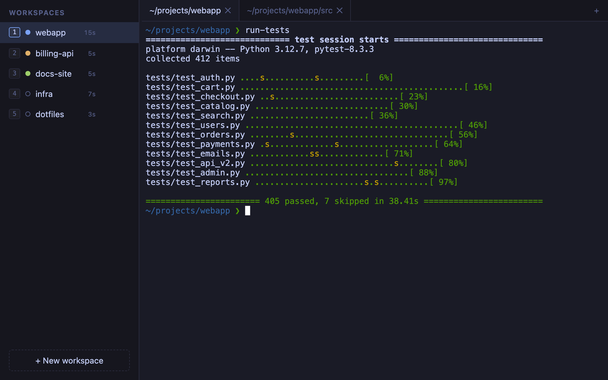
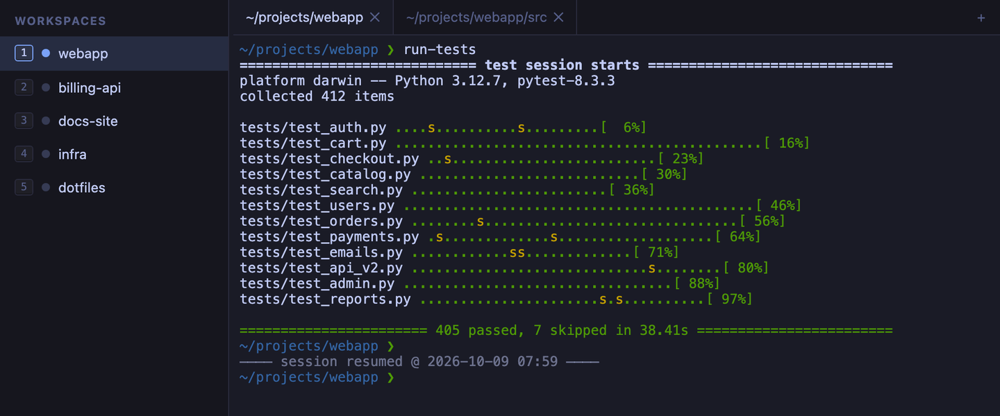
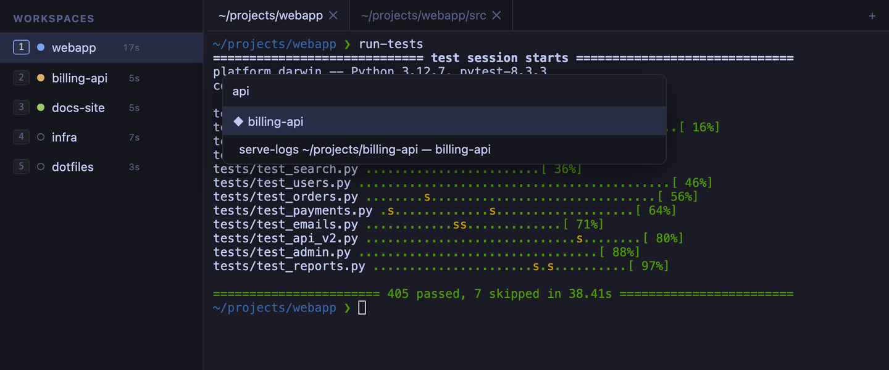
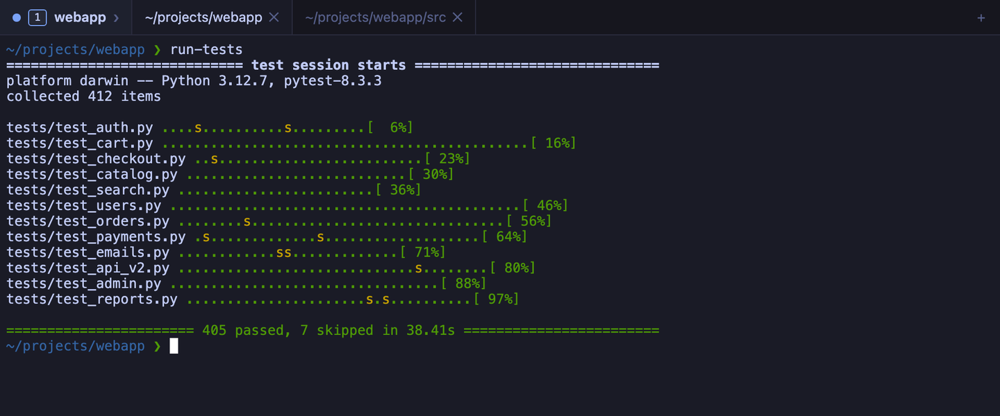

# Introducing terminux

You have six projects on the go. Each one has its own directory, its own running server, its own test suite and its own half-finished command. By mid-afternoon they are spread across a dozen terminal windows, and finding the one where the build just finished means clicking through all of them.

**terminux** is a desktop terminal built for that day. Each project gets a **workspace** in a sidebar. Each workspace holds its own **tabs** of real shells, with a small dot next to its name that tells you what is happening there. Quit and reopen terminux: everything is where you left it, including what was on screen. Version **0.10** is out today for macOS, Linux and Windows.



## One workspace per project

The sidebar on the left lists your workspaces. Each one names itself after the directory of its first tab: `cd ~/projects/webapp` and the workspace becomes "webapp" without you typing a name. Rename it if you prefer your own name; it then stays put.

The first nine workspaces show a number, and `Cmd+1` to `Cmd+9` (`Ctrl+Shift+1` to `Ctrl+Shift+9` on Linux and Windows) jumps straight to them. Inside a workspace, tabs work as you expect: open, close, rename, drag to reorder. Switching away never pauses anything. A server keeps logging and a build keeps building in the background; their output is there when you come back.

Next to each name, terminux shows how long you have actively worked in that workspace since it started. It's handy when someone asks where your day went.

## Know when something is done

The dot next to each workspace works like a traffic light:

- **blue**: the workspace you are looking at;
- **amber**: something is running there and producing output, like the API server streaming its logs in the screenshot above;
- **green**: a task finished while you were elsewhere (the docs site's build, above), so it's ready for you.

This works without any setup. terminux notices when a program that was busy goes quiet, when a program rings the terminal bell, or when a tool sends a desktop-style notification. It ignores the window-title updates that tools like Claude Code send constantly. Add the three-line [shell integration](https://terminux.lab.abilian.com/guides/shell-integration/) snippet to your shell's config and the green dot becomes exact: it lights up when any command that ran for more than two seconds completes.

## Quit, reopen, pick up where you left off

Close terminux in the evening, or let your laptop restart for an update. When you open it again, your workspaces, tabs, window size, font size and each tab's working directory are back. So is the visible scrollback of every tab, replayed above a dim line that marks where the old session ends:



The shells themselves are new, so a program that was running before the restart is not running anymore; the output above the line is a record of it. Full-screen programs (an editor, Claude Code, `less`) don't come back either, because they clear their screen when they exit. The [FAQ](https://terminux.lab.abilian.com/faq/) explains what is restored and what isn't.

## Everything from the keyboard

`Cmd+P` (`Ctrl+Shift+O` on Linux and Windows) opens a quick switcher. Type a few letters of a workspace or a tab and press Enter:



The command palette (`Cmd+Shift+P` on macOS, `Ctrl+Shift+P` elsewhere) gives you everything else: you can sort the sidebar by activity, show usage stats, or toggle preferences. There is find-in-terminal, font zoom, and `Cmd`+click or `Ctrl`+click to open a link in your browser.

Shortcuts follow each platform's habits. On macOS the app uses `Cmd`, so every `Ctrl` chord goes to your shell. On Linux and Windows it uses `Ctrl+Shift`, like GNOME Terminal and Windows Terminal, so `Ctrl+R`, `Ctrl+W` and friends keep working in your shell. `Shift+Enter` inserts a newline in tools that support it, Claude Code among them.

## Hide the sidebar, keep your bearings

When you need the whole width for a log or a diff, `Cmd+B` (`Ctrl+Shift+B` on Linux and Windows) hides the sidebar. The current workspace's dot, number and name then sit at the left of the tab bar, so you still know where you are; click them to bring the sidebar back.



## Your shells, on another machine

terminux can also run as a server. Start `terminux --server` on a desktop or a remote box, open an SSH tunnel from your laptop, and run `terminux --connect` there. You get the same window, but the shells run on the server: close the lid, change networks, come back the next morning, and the terminals reconnect on their own and repaint what happened meanwhile. You don't need to remember the commands: **Show remote connection URL**, in the command palette, prints the `ssh` and `terminux --connect` lines to copy, with the port and access code filled in. You can keep a window open on both machines, too. Each terminal follows the window you are actually using, so neither screen gets scrambled. The [remote access guide](https://terminux.lab.abilian.com/guides/remote/) has the details, including a systemd unit to keep the server running.

## On macOS, Linux and Windows

terminux runs the same way on all three. On Windows 10 and 11 it opens PowerShell 7 if you have it; otherwise it falls back to Windows PowerShell, then `cmd`. Shortcuts follow Windows Terminal: `Ctrl+Shift+T` for a new tab, `Ctrl+Shift+P` for the command palette, `Ctrl+C` to copy a selection, `Ctrl+V` to paste, and plain `Ctrl+=` and `Ctrl+-` for zoom. Add the PowerShell snippet from the [shell integration guide](https://terminux.lab.abilian.com/guides/shell-integration/) and workspaces name themselves after your directory there too. A Windows laptop also makes a fine client for a terminux server on a Linux box or a Mac.

## Small, local, and sturdy

terminux has no account and no telemetry. All its state lives in files on your machine that you can read: a `state.json` and one scrollback file per tab. The app only listens on your own machine unless you ask otherwise. Every connection needs an access code.

It is also small on purpose. Editors, AI assistants, git clients and file browsers already live in your shell, so terminux leaves them out. The effort goes into what a terminal must never do: freeze, lose a session, or corrupt its saved state. A program that stops reading its input can't hang the whole app, saves are atomic. A built-in watchdog writes a diagnosis to the log if the app ever stalls.

## Under the hood

For the curious, terminux is two cooperating parts:

- **A Python backend** (Starlette on uvicorn) owns the real pseudo-terminals (through ConPTY on Windows), streams their output, and saves your layout and scrollback. It speaks a small, documented [HTTP and WebSocket API](https://terminux.lab.abilian.com/developers/api/).
- **A TypeScript frontend** renders the terminals with [xterm.js](https://xtermjs.org/) inside a native window ([pywebview](https://pywebview.flowrl.com/)). Because it's a web page, the same interface also runs in a browser, which is what makes remote mode and the end-to-end tests cheap.

The sidebar, tab bar and palettes use [Preact](https://preactjs.com/). terminux refreshes the sidebar every two seconds. Preact patches only what changed, so the refresh can't wipe a rename or a drag in progress. It adds about 4 KB to the page. The terminals themselves stay plain xterm.js.

The test suite runs at three levels: unit tests, integration tests against a live server and real shells, and Playwright tests that drive the actual interface in a browser. The Python code passes four type checkers. The [architecture page](https://terminux.lab.abilian.com/developers/architecture/) goes into more detail.

## Try it

terminux is on PyPI. It runs on macOS, Linux and Windows 10/11, with Python 3.12 or later. With [uv](https://docs.astral.sh/uv/):

```bash
uvx terminux                  # try it without installing
uv tool install terminux      # install it
uv tool upgrade terminux      # upgrade later
```

The [installation guide](https://terminux.lab.abilian.com/getting-started/) also covers running from source and building a standalone macOS or Linux app.

## What's next

terminux is a preview, and so far its only daily user is its author. These come next:

- **Split panes**, to put two terminals side by side in one tab.
- **A single palette** for commands, workspaces and tabs, on one shortcut on every platform.
- **A standalone Windows app** that needs no Python, and a setting to pick your shell (Git Bash, MSYS2).
- **Proper user accounts**, for running terminux on an open network without an SSH tunnel.

## Get involved

terminux is open source (Apache 2.0):

- **Code**: [github.com/abilian/terminux](https://github.com/abilian/terminux) and [git.sr.ht/~sfermigier/terminux](https://git.sr.ht/~sfermigier/terminux)
- **Docs**: [terminux.lab.abilian.com](https://terminux.lab.abilian.com/)
- **Bugs and ideas**: the [issue tracker](https://github.com/abilian/terminux/issues). A bug report is most useful with the output of a `terminux --debug` run.

If you try it, tell us what felt wrong. That is how every feature above got its current shape.

---

*New to terminux? Start with [Installation](https://terminux.lab.abilian.com/getting-started/), then read about [workspaces and tabs](https://terminux.lab.abilian.com/guides/workspaces-and-tabs/).*
